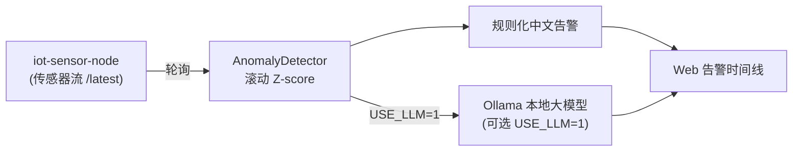

# 🛰️ edge-anomaly-llm · 边缘异常检测 + 大模型告警解读

> 消费 [`iot-sensor-node`](https://github.com/) 的传感器数据流，做**滚动窗口 Z-score 异常检测**；命中异常时，默认给出规则化中文告警，开启后可用**本地 Ollama 大模型**生成「现象 → 原因 → 处置建议」。
> 一条把「嵌入式数据 + AI 分析 + 大模型」串起来的完整链路。

[](https://www.python.org)
[](LICENSE)
[](https://docs.python.org/3/library/)

## ✨ 特性
- 🟢 **零依赖检测**：Z-score 异常检测仅用 Python 标准库，开箱即跑
- 🤖 **可选大模型**：设 `USE_LLM=1` 调用本地 Ollama 生成中文告警解读（无需联网/付费）
- 🔌 **可对接真实设备**：数据源是 HTTP `/latest`，把 `SENSOR_URL` 指向任何输出该格式的源即可
- 📜 **Web 时间线**：实时展示异常事件、Z 分数与解读
- 🔗 **端—边—云联动**：与 `iot-sensor-node`（端）、`llm-rag-kb`（云）组成完整故事

## 🏗️ 架构



## 📂 目录结构
```
edge-anomaly-llm/
├── run.py                 # 启动入口
├── detector/
│   ├── core.py            # 检测器 + 规则/LLM 解读
│   └── server.py          # 轮询 + Web 时间线服务
└── dashboard/
    └── timeline.html      # 告警时间线看板
```

## 🚀 快速开始

### 1）先启动数据源（详见 iot-sensor-node）
```bash
cd ../iot-sensor-node && python run.py
```

### 2）启动异常检测（规则模式，零依赖）
```bash
python run.py
# 时间线: http://localhost:8001/
# 告警:   http://localhost:8001/alerts
```
模拟器默认约 4% 概率注入异常，运行几十秒即可在时间线看到告警。

### 3）启用本地大模型解读（可选）
```bash
# 先安装并运行 Ollama，拉取一个轻量模型
ollama pull qwen2.5:1.5b
# 启动检测服务，开启 LLM 解读
USE_LLM=1 OLLAMA_MODEL=qwen2.5:1.5b python run.py
```

常用环境变量：`SENSOR_URL`（数据源，默认 `http://localhost:8000/latest`）、`ANOM_PORT`（默认 8001）、`ANOM_WINDOW`（窗口，默认 30）、`ANOM_Z`（Z 阈值，默认 3.0）、`POLL_INTERVAL`（轮询间隔，默认 1.0）。

## 🧠 检测原理
对每个节点的每个指标维护长度为 `WINDOW` 的滚动窗口，计算均值与标准差；当某次读数偏离均值超过 `Z` 倍标准差即判为异常。命中后用规则模板，或（开启时）用本地大模型生成更自然的「现象 / 原因 / 建议」三段式解读。

## 🗺️ 路线图
- [ ] 支持多指标联合异常（如温度↑且湿度↓同时触发）
- [ ] 异常等级分级与去抖（连续 N 次才告警）
- [ ] 对接 `llm-rag-kb`，让告警自动检索处置手册

## 📄 License
[MIT](LICENSE) © 2026 Wooji
